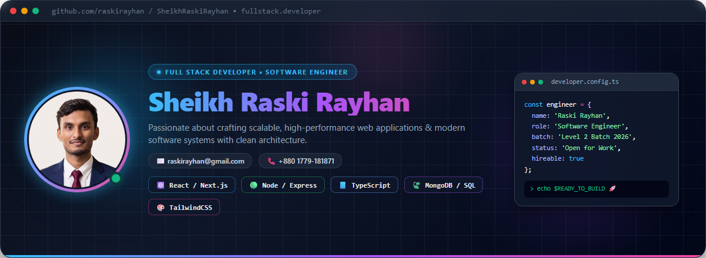

  <!-- Banner Header with Embedded Profile Photo -->
  

    

  <!-- Dynamic Typing Header / Subtitle -->
  

    

  <!-- Social & Contact Badges -->
  

    
    
    
    
    
  

  <!-- Quick Profile Badges -->
  

    
    
    
    
  

---

### 🌟 About Me

Hello world! 👋  
I'm **Sheikh Raski Rayhan**, an enthusiastic and results-driven **Full Stack Developer & Software Engineer**. I love architecting and developing scalable, modern web applications with clean code, robust backend architectures, and engaging frontend designs.

- 🔭 **Currently Working On:** Advanced full-stack web applications & microservices using **React, Next.js, Node.js, and Express**.
- 🎓 **Ongoing Journey:** Honing deep software engineering skills in **Programming Hero Level 2 (Batch 2026)**.
- 💡 **Core Expertise:** MERN Stack, Next.js, TypeScript, RESTful API design, database modeling, and state management.
- 👯 **Open For:** Collaborations on innovative web applications, open-source initiatives, and software engineering roles.
- 💬 **Ask Me About:** JavaScript, TypeScript, React, Next.js, Node.js, Express, MongoDB, PostgreSQL, and Clean Architecture.
- ⚡ **Fun Fact:** I treat debugging like solving a high-stakes puzzle — and I never stop until the code is elegant and performant!

---

### 🛠️ Tech Stack & Skills

#### 🌐 Frontend Development

  
  
  
  
  
  
  
  
  

#### ⚙️ Backend & API Development

  
  
  
  
  

#### 🗄️ Databases & ORM

  
  
  
  
  
  

#### 🛠️ DevOps, Tools & Workflow

  
  
  
  
  
  
  
  

---

### 🚀 Featured Projects

| Project | Description | Tech Stack | Links |
| :--- | :--- | :--- | :--- |
| **🛠️ FixItNow** | Modern on-demand repair, booking, and home maintenance platform with interactive booking workflow & clean responsive UI. | `React` `Next.js` `Node.js` `Express` `MongoDB` `TailwindCSS` | [Live Demo ↗](https://fix-it-now-taupe.vercel.app/) • [Code ↗](https://github.com/raskirayhan/FixItNow-) |
| **🏛️ G3 Architects Agency** | Professional architectural firm showcase platform featuring sleek project portfolios, client testimonials, and responsive layouts. | `React` `JavaScript` `TailwindCSS` `UI/UX` | [Live Demo ↗](https://g3-architect-website-repo.vercel.app/) • [Code ↗](https://github.com/raskirayhan/g3-architect-website-repo) |
| **🐾 WarmPaws** | Compassionate pet adoption & animal rescue platform connecting animals in need with caring homes and community support. | `MERN Stack` `Authentication` `REST APIs` `TailwindCSS` | [Live Demo ↗](https://github.com/raskirayhan/WarmPaws) • [Code ↗](https://github.com/raskirayhan/WarmPaws) |

---

### 🟩 GitHub Contribution Calendar & Activity

  

    <b>🔥 Contributions Across 2026</b>
  

  <!-- Live GitHub Contribution Heatmap Chart -->
  

    

  <!-- GitHub Streak Counter -->
  

---

### 📊 GitHub Metrics & Statistics

  <table border="0">
    <tr>
      <td width="50%">
        
      </td>
      <td width="50%">
        
      </td>
    </tr>
  </table>

---

### 🏆 GitHub Trophies

  

---

### 📬 Let's Connect & Collaborate!

I'm always open to discussing new software projects, collaborative opportunities, or tech talks!

| Channel | Contact Info / Link |
| :--- | :--- |
| 📧 **Email** | [raskirayhan@gmail.com](mailto:raskirayhan@gmail.com) |
| 💼 **LinkedIn** | [linkedin.com/in/sheikh-raski-rayhan-36b588334](https://www.linkedin.com/in/sheikh-raski-rayhan-36b588334/) |
| 📘 **Facebook** | [facebook.com/skraskirayhan](https://www.facebook.com/skraskirayhan/) |
| 📱 **Phone / WhatsApp** | [+880 1779-181871](https://wa.me/8801779181871) |
| 🐙 **GitHub** | [@raskirayhan](https://github.com/raskirayhan) |

 

  Designed &amp; Developed with ❤️ by <b>Sheikh Raski Rayhan</b> | &copy; 2026 All Rights Reserved

